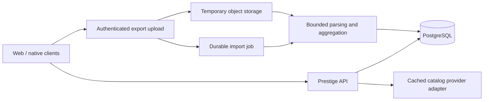

# Prestige: personal music catalog and web launch

Working brief and source audit, October 15, 2026. This documents the agreed product direction and proposed implementation; it does not describe an already completed migration.

## Confirmed direction

Prestige becomes a social music rating and ranking platform positioned as a Rate Your Music competitor: rate music, rank tracks within albums, curate a profile that feels like a trophy case, and explore those opinions with friends. Preserve and elevate the existing Beli-style rating mechanic within that broader positioning.

The product has two layers. The core social catalog works without Spotify. The distinctive **prestige** layer is optional, gated behind Spotify integration and listening data. Its additional onboarding friction and processing costs must not become requirements for rating music or participating socially. After proving the core concept, gradually introduce more granular tracking and work toward near-real-time prestige calculations. Continuous tracking is deferred, not permanently abandoned.

- Launch on the web, bringing over useful native functionality and integrating the separate brand redesign.
- Start with API and storage changes. Keep visual design work with the redesign effort.
- Launch without continuous Spotify listening collection. User-requested Spotify exports are the initial candidate for optional historical prestige; more frequent collection is a later rollout after proof of concept.
- Users should be able to get value before requesting or uploading an export. This is a proposed onboarding requirement derived from the stated friction.
- Target approximately **$20/month** for the initial public launch, with no active users today.
- **No existing production data needs preservation.** A fresh database baseline is available; preserve useful code and rating behavior rather than building an unnecessary historical data migration.

## What exists today

| Area | Source evidence | Implication |
| --- | --- | --- |
| Web | `Prestige.Web`: React 18, TypeScript, Vite, TanStack Query, Auth0 | Extend the existing application; a frontend framework rewrite is not required by the pivot. |
| API | `Prestige.Api/Program.cs`, `Data/PrestigeContext.cs`: .NET 9, EF Core, SQL Server production path | Business logic is reusable; production startup and migrations are tied to SQL Server. |
| Local development | `LocalDemo` startup path: SQLite and seeded identity/data | Useful baseline without cloud services; demo authentication must never be a production fallback. |
| Listening collection | `Prestige.Functions/RecentlyPlayed.cs`: hourly timer, skips six quiet hours, enumerates users, reads Spotify recent plays | Work scales with registered users even without app visits. Source schedule implies roughly 18 collection passes per day; actual deployed configuration was not inspected. |
| Processing | `CosmosDBParser.cs` posts each event to `prestige/{userId}/tracks`; `PrestigeServices.cs` increments track/album/artist totals and fetches missing metadata | One play can cause multiple reads, writes, and provider calls. This is the main architectural source of repeated work. |
| Export import | `SpotifyDataImportStreamingFunction.cs`: multipart upload, temporary file, Blob Storage, JSON/ZIP parsing, Cosmos documents, SQL import history | Imports still depend on the old processing architecture. Removing the timer alone does not remove Cosmos or the per-event pipeline. |
| Extra background activity | `Program.cs`: Hangfire comparison cleanup, SQL maintenance, profile-picture sync, hourly personal Spotify-token refresh | Catalog mode should not start these jobs. Previously persisted recurring jobs also need retirement when changing an existing deployment. |
| Ratings | `Domain/Rating.cs`, `Endpoints/Rating/RatingServices.cs` | Categories, comparison history, positions, album context, and album-wide track ranks already exist. |
| Personal collection | `UserTrack`, `UserAlbum`, `UserArtist` combine time totals, favorites, pins, and duplicated rating fields | Curation needs its own lifecycle independent of listening events. |
| Identity | `UserServices.CreateUserAsync` requires upstream access/refresh tokens; multiple services split the Auth0 subject at `|` | A Spotify-independent account cannot simply use the current signup path unchanged. |

This audit examined source code and local builds. It did not inspect Azure billing, live databases, provider account entitlements, deployed settings, or live traffic. Cost drivers are architectural findings, not a measured breakdown of the old bill.

## Preserve the rating semantics

The existing implementation treats tracks differently from albums/artists:

- Albums/artists have category-relative positions and derived personal scores.
- Tracks have positions within an album/category and an album-wide `RankWithinAlbum` across categories. Their current score is a category-bound placeholder, not an independently calculated numerical song review.
- Comparison history is stored separately and used by ranking logic.

Do not silently turn track ranks into global song scores. Characterize existing insertion, category changes, comparison behavior, and deletion before refactoring. Make ranking updates atomic and define concurrency behavior: current track saves use multiple `SaveChangesAsync` calls without an encompassing transaction. `Rating` should be the authoritative record; duplicated score fields on collection joins should be removed or treated explicitly as derived projections.

## Native-to-web parity findings

| Capability | Current state | Web work |
| --- | --- | --- |
| Basic ratings and comparisons | Implemented in both clients | Preserve behavior and improve presentation through the redesign. |
| Track ranking inside an album | Already in web `AlbumPage.tsx` and native `AlbumDetailView.swift` | Elevate it into a core browsing/sharing experience; it is not a missing feature from scratch. |
| Friend-specific item details and rankings | Native `APIClient.swift` consumes friend item, album-track, and artist-album endpoints | Web `useFriends.tsx` and friend profile are less complete; port the friend-context flows. |
| Taste comparison | Native has richer comparison views; web has basic comparison models/hooks | Expose comparable ratings/ranks clearly, independent of listening time. |
| Import onboarding | Native has request walkthrough, upload sessions, progress, history; web uses a direct hardcoded Functions URL | Give web one authenticated import API and a useful experience before import. |
| Profile as a curated display | Favorites/pins exist; web friend profile emphasizes top listening and live activity | Build the redesign around chosen music, opinions, ranks, and stable share links. |

Native README claims were not treated as proof that a feature is implemented. Native was inspected at source level, not built or exercised in a simulator.

## Proposed backend and storage

Retain the .NET API and React application. Move to one relational database, with **PostgreSQL as the leading candidate**, and an import worker that runs for submitted jobs. Avoid requiring Cosmos, Redis, a separate always-running worker service, or recurring Spotify collection for launch.

The worker can initially share the API deployment with bounded concurrency, provided job state and upload files survive restarts. Keep compute-heavy parsing out of request lifetimes. A durable job table does not require aggressive perpetual polling: use an in-process wakeup for new jobs plus recovery at startup and bounded recovery checks. Measure the database wake time this introduces before selecting a serverless database plan.

### Data boundaries

| Boundary | Proposed records and rules |
| --- | --- |
| Identity | Internal user ID, profile, and external identity mapping keyed by issuer + full subject. Spotify connection is optional and separate. |
| Catalog | Artists, album releases, tracks, and album-track membership with disc/track order. Internal IDs plus unique provider IDs. Store metadata provenance and resolution status; do not merge releases solely by matching titles. |
| Personal catalog | User-item collection membership, favorites, and ordered showcase slots. Adding/rating/pinning music does not require a listening-total row. |
| Opinions | Ratings, categories, comparison history, and scoped rankings. Authorize against the signed-in user; transact changes to a ranking together. |
| Social | Friend relationships, explicit visibility, and stable profile/album-ranking links. Share responses must omit account tokens and private import data. |
| Imports | Jobs, files, hashes, parser version, counts, coverage, failure/retry state, and durable checkpoints. An upload receipt is not proof that aggregation completed. |
| Historical context | Compact per-user/per-item aggregates with source and coverage dates; use 64-bit totals with explicit units. Keep sufficient deduplication information to prevent overlapping exports being counted twice. |

A fresh PostgreSQL migration baseline should be separate from the old SQL Server migration chain. Do not merely change the EF provider and assume the old migrations work. Use PostgreSQL in integration tests for PostgreSQL behavior; SQLite demo success is insufficient.

### Import behavior

1. Authenticate upload, job polling, and history reads. Derive ownership from the principal and bind upload sessions to it.
2. Bound upload size, ZIP entry count and uncompressed bytes, parser memory, job concurrency, and retry count.
3. Parse supported export formats explicitly. The current importer expects extended-history fields such as `ts`, `ms_played`, and `spotify_track_uri`; do not label arbitrary Spotify JSON as supported.
4. Retain usable track/artist/album names from the export instead of dropping them and immediately fetching everything again. Exclude unrelated personal fields such as IP addresses from stored catalog data.
5. Normalize event identity independently of import job ID. A file hash catches identical files, not overlapping exports. Specify timestamp precision and collision behavior before adopting event fingerprints; preserve legitimate distinct events.
6. Merge only newly accepted events and update aggregates/checkpoints transactionally. Retrying or resuming must not increment totals twice.
7. Keep partial catalog entries usable while unresolved metadata is enriched separately. Never fabricate a complete album track list from only the tracks a user played.
8. Remove temporary uploads after completion or an explicit bounded retention window. Retain compact deduplication/provenance records, not the entire rich export indefinitely. If these records outgrow the initial database allowance, change the retention/reimport design deliberately rather than sacrificing correctness.

The current importer uses `{trackId}_{timestamp}_{batchId}` document IDs, so a different batch can repeat the same play. It counts an item as imported before the bulk result and clears the buffer after logging failures. These are correctness issues to resolve in the replacement, alongside cost reduction.

## Spotify and catalog independence

Exports remove listening-history requests; they do not automatically solve signup, search, artwork, release identity, or complete track lists. Spotify's [export documentation](https://support.spotify.com/us/article/understanding-your-data/) lists names, listening timestamps/duration, and track URIs in extended history. That is valuable import input, not a complete music catalog.

The current album-ranking read path calls Spotify on every request, and `Track` does not persist disc/track numbers. Persist sufficient catalog metadata and serve stored details without an upstream call on each view.

Spotify's current [quota documentation](https://developer.spotify.com/documentation/web-api/concepts/quota-modes) describes development-mode allowlisting and a five-authenticated-user limit, as well as separate request quotas. Prestige's actual app entitlement is unknown. Public launch cannot assume that reducing request frequency grants broader access.

Evaluate a provider-independent metadata path with a small representative catalog before committing to it. [MusicBrainz](https://musicbrainz.org/doc/MusicBrainz_API) is a candidate for release/track metadata; evaluate matching quality, artwork coverage, [rate limits](https://musicbrainz.org/doc/MusicBrainz_API/Rate_Limiting), and [data licensing](https://musicbrainz.org/doc/About/Data_License). Imported names and provider IDs should remain usable when enrichment fails. Do not bulk mirror a global catalog for an empty launch.

## Budget direction

Illustrative launch configuration, not a committed provider choice or guaranteed invoice:

| Component | Candidate | Budget reasoning |
| --- | --- | --- |
| Web assets | Cloudflare Pages | Static asset requests are free under the [published pricing](https://developers.cloudflare.com/pages/functions/pricing/). Dynamic share previews, if added there, have separate function limits. |
| API and bounded import processor | One small container service | Render advertises a $7/month, 512 MB option on its [pricing page](https://render.com/pricing). Verify workspace charges and measure .NET/import memory before adopting it. |
| Database | Neon PostgreSQL | [Free/usage-based plans and idle suspension](https://neon.com/pricing) fit a low-activity launch candidate. Storage, backup history, wake time, and limits matter; free-tier capacity is not an unlimited production guarantee. |
| Login | Existing Auth0 integration with a non-Spotify sign-in path | Check the tenant against the [current free plan](https://auth0.com/pricing); removing Spotify identity assumptions need not require replacing the auth vendor. |
| Upload storage, backups, headroom | Small allowance from the remaining budget | Select after measuring representative exports and testing restore. Avoid paid recurring services for empty queues. |

Target a roughly $7 compute floor and reserve the remaining ~$13 for database/storage/backups and usage. This excludes taxes, domain registration, and any paid music-data agreement; provider entitlements and those costs must be checked before launch. A free database can fit initial inactivity, but benchmark import size before assuming it fits real users.

[Supabase Pro starts at $25/month](https://supabase.com/pricing), exceeding the target before separate API hosting. Its free tier is an alternative for evaluation; Pro is not the default for this budget. A small VPS with PostgreSQL is another architecture option, but transfers patching and backup operations to us. Retaining Azure temporarily is also possible; eliminating unnecessary work matters more than the vendor name.

## Launch blockers found in source

- **Import authorization:** upload/session/status/history Functions use anonymous triggers and caller-supplied IDs; no application-level ownership enforcement was found in the inspected handlers. Hosting-layer authentication was not inspected. The replacement needs explicit user ownership.
- **Mutation authorization:** pin routes require authentication, but inspected controller/service paths do not verify that the target `userId` is the caller. Review all mutation/read visibility rules before public launch.
- **Demo mode:** current startup permits local-demo authentication via configuration without an environment guard. Production must reject demo mode.
- **Ranking correctness:** multi-step writes, weak input validation, and concurrent edits need characterization and transactional tests.
- **Provider dependency:** account creation, catalog enrichment, and some read paths still depend on Spotify credentials/API availability.
- **Deployment coverage:** both GitHub web deployment workflows build `build:landing`; the full web app build is not the deployed artifact in those definitions. CORS origins are hardcoded.
- **Verification:** API CI invokes `dotnet test` against the application project. No dedicated .NET test project or web test/spec files were found in this repository scan.
- **Operations:** readiness currently reports healthy without checking database availability. Configure secrets, supported runtime versions, migrations, backup/restore, request limits, and bounded logs as part of the deployable slice.

## Implementation order and completion gates

1. **Independent catalog foundation.** Fresh relational schema, internal identity mapping, optional Spotify connection, collection membership, stored album order, and transactional rating behavior. Preserve native-compatible behavior or explicitly version changed contracts. Gate: a new user can add, rate, rank, and pin known catalog music with no listening history and no Spotify call during those actions.
2. **Web parity and redesign integration.** Friend-specific item views, album track ranks, curated profile, and useful onboarding without Spotify or import. Gate: two users can express taste and view each other's allowed profile/rankings through stable links.
3. **Optional prestige and import replacement.** Separate availability/connection state from core accounts. Authenticated jobs, bounded streaming parser, stable deduplication, direct aggregates, and recoverable progress. Gate: opted-in users can add historical prestige, while other users retain the full core social experience; duplicate/overlapping files and retries do not inflate totals; interrupted jobs recover; unresolved metadata does not lose valid imported context.
4. **Deployment and cost validation.** Full app deployment, explicit environment config, fresh DB initialization, production auth guard, health/readiness, restore drill, representative import/load measurement, and service budget. Retire legacy collectors and infrastructure in the actual hosting account. Gate: the user flows work in production and the measured baseline fits approximately $20/month.

After proof of concept: incrementally improve listening-data freshness toward near-real-time prestige. This is a later product phase, not a launch gate. Any new collector must be explicitly enabled, bounded by provider access and per-user cost, and isolated from core rating/social availability. Do not enable the entire legacy infrastructure profile to unlock optional prestige for one user.

## Handoff to the redesign effort

Design around a user's own music choices, album/artist ratings, track order inside an album, friend context, and curated showcase slots. Distinguish original album track order from personal rank. Spotify integration is an optional route into prestige features, not the signup/onboarding requirement. Show history as “imported through [date]” rather than implying live tracking. Plan a profile that feels complete without prestige badges, plus connected/importing/ready states when someone opts in. Reserve room for fresher prestige later without presenting near-real-time tracking as available at launch.

Backend contracts should separate catalog identity, owner/viewer context, rating category/score, rank scope, showcase order, visibility, and optional history provenance. The route names and final response schemas remain to be implemented; this brief is not a promise that new endpoints already exist.

## Audit validation

- API: `dotnet build Prestige.Api/Prestige.Api.csproj --no-restore --nologo` succeeded, 0 errors and 132 warnings.
- Web: `npm run build` succeeded, with a large-bundle warning and large existing image assets.
- Functions and native app were inspected but not built in this audit. No end-to-end production validation was performed.
- Existing working-tree edits were left intact. This pass adds this brief only; application behavior and hosting have not been changed.

## Implementation progress

The initial audit above is a historical baseline. The implementation now includes a separate PostgreSQL migration chain, a default catalog runtime without Hangfire/Redis/Cosmos registration, production configuration guards, Spotify-independent accounts and web bootstrap, public user search, and a separate personal collection API. Catalog rating changes save collection membership atomically and serialize writes per account on PostgreSQL. See [backend setup](catalog-backend.md) and [collection contracts](collections-api.md). Existing favorites/pin screens still need to adopt that API. Optional prestige access, provider-independent catalog discovery, imports, the remaining authorization review and the redesigned social web experience are still outstanding.

Validation: all 32 API tests passed with real PostgreSQL 15 enabled (zero skips). Coverage now includes identity isolation, collection ownership and constraints, concurrent writes, rating rollback after intermediate saves, and track-category rank repair, alongside the original runtime tests. External hosting and live Azure resources have not been changed.
